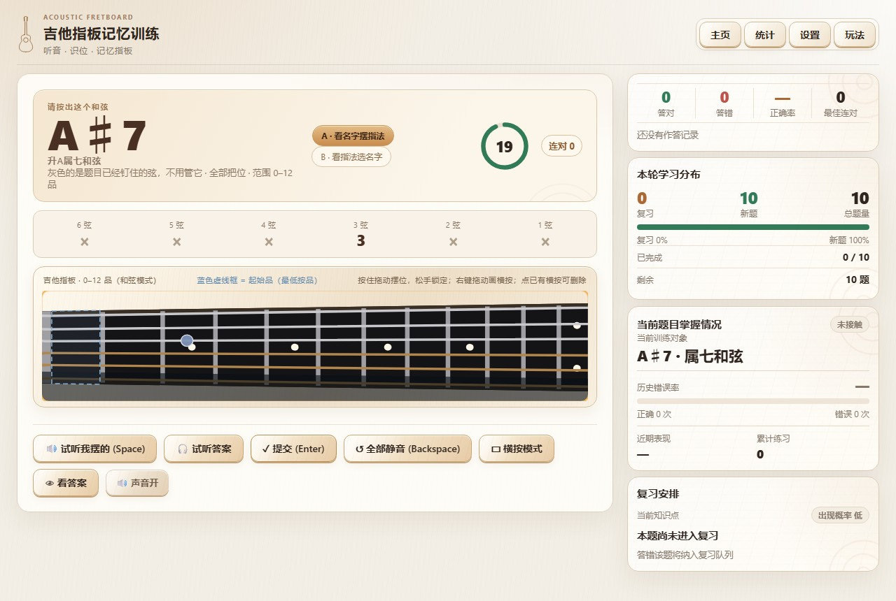
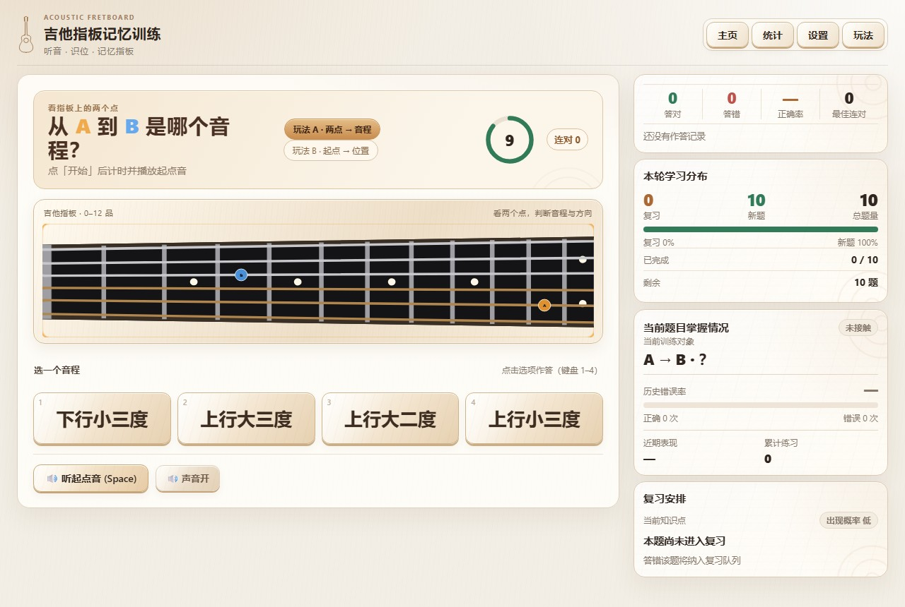
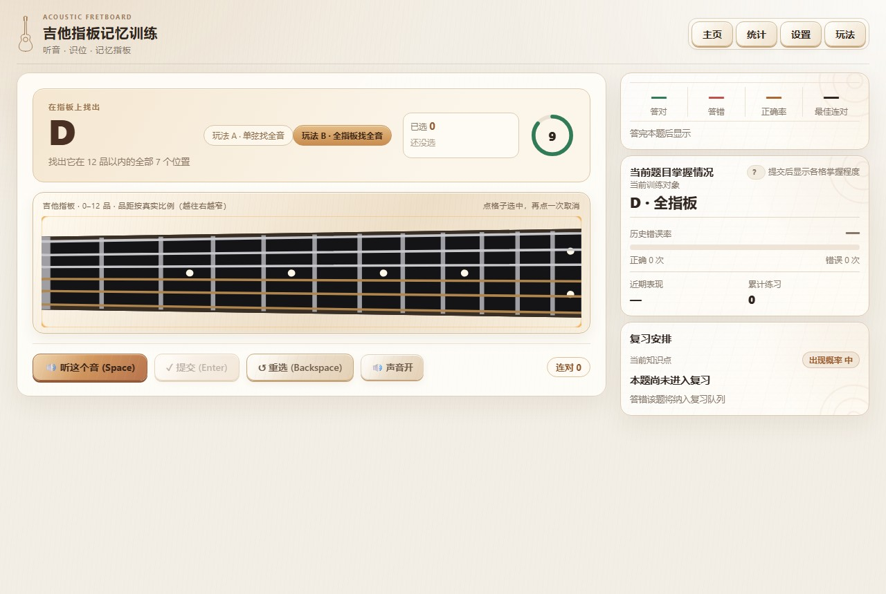
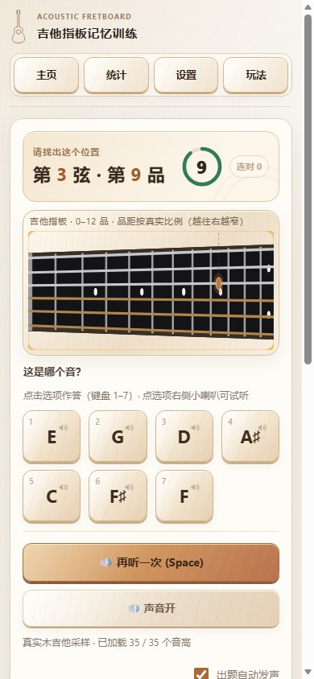

# 吉他指板记忆训练

一个纯前端的吉他指板记忆训练器。四种模式：**音名**（指着指板上的红点说出音名）、**找位置**（给一个音名，找出它在指板上的全部位置）、**和弦**（看名字摆指法／看指法选名字）、**音程**（两点判音程、给起点猜位置）。后三种模式各分 A / B 两套玩法。

线上地址：<https://akifeath.github.io/guitar-fretboard/>

不需要安装、不需要登录、不需要联网（首次打开加载一次后音频会走缓存）。练习记录存在浏览器本地，换浏览器、清缓存、或者换了域名都不会自动跟过去——重要的进度请用「设置 → 数据与重置 → 导出学习数据」存一份 JSON，换地方后再导入。



---

## 四个模式

| 模式 | 练什么 |
|---|---|
| 音名 | 看指板上的红点，说出这个位置的音名（或反过来：听一个音，在指板上点出它的所有位置） |
| 找位置 | 题面只给一个音名，把十二品以内它在所有弦上的位置全找出来——漏一个、多一个都算错 |
| 和弦 | 从 8,437 条真人弹过的指法里出题。玩法 A：看和弦名摆指法；玩法 B：看指法从几个名字里选出它 |
| 音程 | 同一块指板上两个点之间隔着多远——是几度、朝上还是朝下 |

右上角「主页」随时换模式，「统计」看历史，「设置」调限时、音名写法、提示强度，「玩法」是当前模式内的细分玩法。



---

## 几个可能想知道的细节

**指板是矢量的，不是位图。** 指板画成 SVG，放大也不会糊；主页那段整琴旋转放大的入场动画用的是同一张矢量图。品柱间距按真实比例（越往右越窄），空弦区在琴枕左侧，点一下就是空弦。

**声音是真采样。** 35 个木吉他单音采样，不是合成器。答题时可以随时「听一遍」——音名模式播题目那个音，找位置模式播这根弦上该音名最低的那个把位，和弦模式可以听你自己摆的那条指法、也可以听正确答案，音程模式只播起点音（绝不播目标音，否则答案直接暴露）。

**和弦题不是程序拼的。** 8,437 条指法是从一份真人弹唱曲库里整理出来的，一条指法一道题。名字和指法对不上的、有多种叫法的题会被挑出来单独处理：有的会把有区别的那几根弦先钉住（灰蓝色），有的在选项里剔掉「换个名字似乎也说得通」的干扰项。

**记录分三层。** 音名/找位置按「弦 + 品」逐格记；和弦按「根音 + 质量」记卡片、每个具体指法另有一份题级统计；音程按「玩法 + 音程 + 方向」记。互不影响，换玩法不会把之前的成绩算混。

**做题中途的取舍。** 答错会停在这一步，让你先听一遍正确的音再点下一题；提示强度可以在设置里调（只说哪几根弦不对／逐弦说明／关掉提示）。想给自己留一道关，可以把「提交前可以听正确答案」关掉。



---

## 关于这个仓库

这个仓库是**成品站点的发布副本**：只放浏览器实际会加载的文件（`index.html`、`style.css`、8 个脚本、`assets/` 里的 SVG、`samples/` 里的 35 个 mp3），一共 55 个文件、8.3 MB。

开发和测试的那套东西（源码 `app.src.js`、构建脚本、47 组测试脚本含浏览器回归、内部设计文档）不在这里，它们在本地仓库里维护。改功能请在本地改完、跑过测试、构建出发布文件后再同步到这个仓库——**不要在这里直接手改 `app.js`**，它是 `app.src.js` 的构建产物，下次同步会被覆盖。

### 目录

```
index.html            入口页
style.css             全部样式
app.js                主程序（构建产物）
board-svg.js          指板模块：载入 / 坐标 / 命中 / 标注
board-svg-source.js   指板 SVG 内联源（构建产物）
guitar-data.js        整琴矢量图内联源（构建产物，入场动画用）
chord-theory.js       和弦理论层（构建产物）
chord-bank-data.js    和弦题库 8,437 条指法（构建产物）
interval-theory.js    音程理论层（构建产物）
home-intro.js         主页入场动画
assets/guitar/        指板与整琴的源 SVG
samples/acoustic/     35 个木吉他单音采样
screenshots/          本文档里的几张图
.nojekyll             让 GitHub Pages 原样发布，不走 Jekyll
```

### 同步到这里的清单

从本地开发目录复制以下 11 项（其余一律不带）：

```
index.html  style.css  app.js  board-svg.js  board-svg-source.js
guitar-data.js  chord-theory.js  chord-bank-data.js  interval-theory.js
home-intro.js  assets/guitar/  samples/acoustic/
```

### 部署

GitHub → Settings → Pages → Source 选 **Deploy from a branch**，分支 `main`，目录 `/(root)`。推上去一分多钟生效。

### 本地看

`index.html` 直接用双击打开也能看，但 `file://` 下浏览器会拦 `fetch` 读 SVG：指板会退回静态图、**点不动**，声音走 `<audio>` 降级通道。想看完整效果就起个静态服务器：

```powershell
# 任选其一，然后在浏览器打开 http://127.0.0.1:8080/
npx serve .
python -m http.server 8080
```

### 兼容性

需要较新的 Chrome / Edge / Safari / Firefox（用了 ES2020、SVG、Web Audio）。手机上能用，布局在 390px 宽度以上有专门适配；指板的横按在触屏上要先点「横按模式」再拖动——触屏没有右键。



### 许可

给自己练琴用的，拿去练就好。
